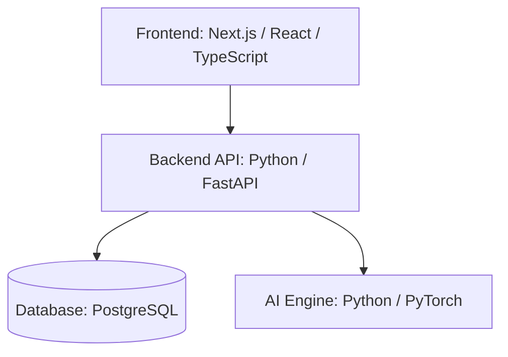

# NOCVIAN — System Architecture

**Project:** NOCVIAN — Building What's Next  
**Document Version:** 0.1  
**Status:** Draft  
**Related GitHub Issue:** NOC-002

## 1. Purpose

NOCVIAN is a planned enterprise intelligence platform designed to help organizations securely manage information, access knowledge, and use AI-assisted workflows.

The first release will focus on a working enterprise application with secure user access, organizational workspaces, document processing, search, and AI-assisted answers.

Future releases may include independently developed AI models, agentic workflows, MCP integrations, multi-agent orchestration, and industry-specific modules.

## 2. Architecture Approach

NOCVIAN will initially use a modular monolith architecture.

A modular monolith is an application organized into separate functional modules while being deployed as a manageable application rather than many independent microservices.

This approach reduces early operational complexity and supports future expansion.

### Initial Architecture Diagram

The following diagram shows the initial logical components of NOCVIAN. It is a simplified overview, not a deployment or security-boundary diagram.

The frontend communicates with the backend API. The backend coordinates authorized access to application data and AI functionality. Additional security and processing boundaries will be documented in later diagrams.

## 3. Initial Technology Stack

| Layer | Technology | Purpose |
|---|---|---|
| Frontend | Next.js, React, TypeScript | User interface |
| Backend | Python, FastAPI | Business logic and APIs |
| Database | PostgreSQL | Persistent application data |
| AI development | Python, PyTorch | Model development and inference |
| Testing | pytest and frontend testing tools | Verify application behavior |
| Version control | Git and GitHub | Track source code changes |
| Deployment | Docker and cloud infrastructure | Package and run the application |

These are initial technology decisions and may be revised through documented architecture reviews.

## 4. Core Components

### 4.1 Frontend

The frontend provides the user interface, including sign-in, dashboards, document uploads, search, and AI interactions.

### 4.2 Backend

The backend handles incoming API requests, validates data, enforces permissions, and coordinates application services.

### 4.3 Database

PostgreSQL stores application information, including users, organizations, workspace metadata, document records, and audit information.

### 4.4 AI Engine

The AI engine will provide a controlled interface for model inference, retrieval-assisted answering, and future original model experiments.

## 5. Security Principles

- Authenticate users before allowing protected access.
- Enforce authorization on the server.
- Isolate organizational data.
- Protect secrets and sensitive information.
- Record security-relevant activities.
- Validate user inputs and uploaded files.
- Require human approval for high-risk automated actions.

## 6. Future Architecture Extensions

- Document ingestion and processing
- Hybrid search and retrieval-augmented generation
- NOCVIAN-Tiny model research
- Agentic AI orchestration
- MCP integrations
- Multi-agent systems
- Industry-specific modules
- Monitoring, backup, and recovery

## 7. Architecture Review Checklist

- [ ] Confirm first-release requirements.
- [ ] Create detailed component diagram.
- [ ] Define component responsibilities.
- [ ] Define API communication patterns.
- [ ] Design database boundaries.
- [ ] Define authentication and authorization.
- [ ] Review tenant isolation.
- [ ] Identify major architecture risks.
- [ ] Define deployment architecture.
- [ ] Review and approve the initial design.

## 8. Current Status

This document is an initial architecture draft. Detailed design, diagrams, security reviews, and architecture validation are still pending.
