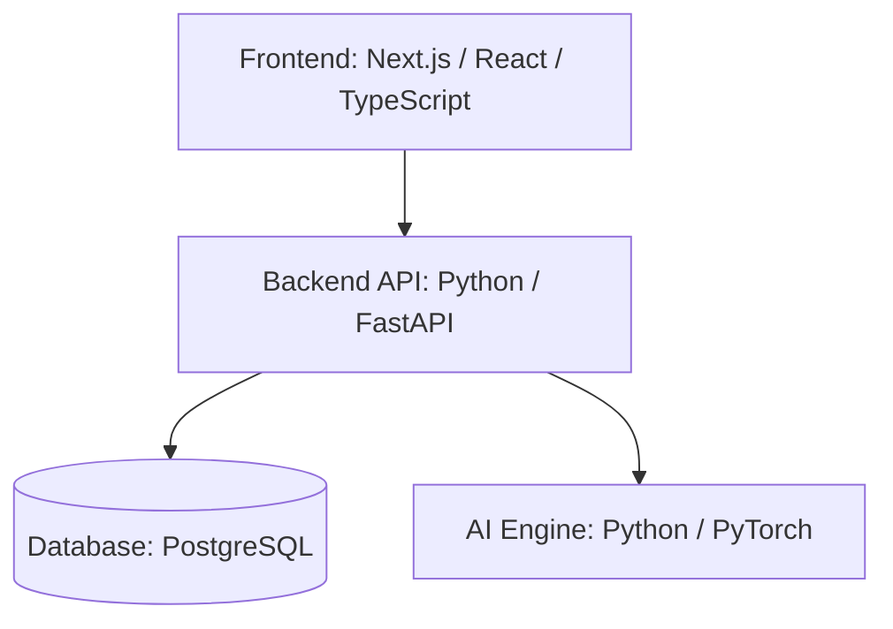
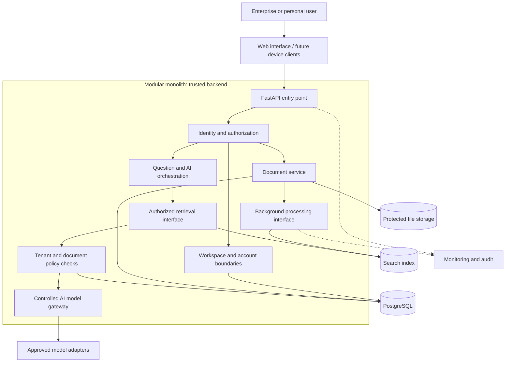

# NOCVIAN — System Architecture

**Project:** NOCVIAN — Building What's Next  
**Document Version:** 0.2
**Status:** Draft  
**Related GitHub Issue:** NOC-002
**Requirements:** `../requirements/README.md`

## 1. Purpose

NOCVIAN is a planned human-centered universal intelligence platform for enterprise and personal experiences. Its first release will focus on a working enterprise application with secure user access, organizational workspaces, document processing, search, and AI-assisted answers. Personal experiences, multimodal AI, adaptive learning, agents, and proprietary models are future capabilities, not features already implemented.

## 2. Architecture Approach

NOCVIAN will initially use a **modular monolith**: distinct functional modules in a manageable backend deployment, with explicit interfaces and tests. This reduces initial operational complexity while allowing justified future extraction of services.

### Initial Architecture Diagram

The following diagram preserves the initial four-component logical overview. It is not a deployment or complete security-boundary diagram.

The frontend communicates with the backend API. The backend coordinates authorized access to application data and AI functionality. The AI engine does not receive unrestricted database access.

### Proposed Detailed Logical Diagram

This is a **proposed logical design**, not an implementation. Arrows represent conceptual interactions, not proof of complete authorization or deployed services. Every file, retrieval, and tool-access path must enforce applicable policy; a single upstream check is insufficient. Worker, storage, index, and model technologies remain undecided.

## 3. Initial Technology Stack

| Layer | Technology | Purpose |
| --- | --- | --- |
| Frontend | Next.js, React, TypeScript | User interface |
| Backend | Python, FastAPI | Business logic and APIs |
| Database | PostgreSQL | Persistent application data |
| AI development | Python, PyTorch | Model development and inference experiments |
| Testing | pytest and frontend testing tools | Verify application behavior |
| Version control | Git and GitHub | Track source code changes |
| Deployment | Docker and cloud infrastructure | Package and run the application |

These are initial technology decisions and may be revised through documented reviews. A barcode decoder, queue, file store, search engine, and production model provider have **not** been selected.

## 4. Core Components and Responsibilities

### 4.1 Frontend

Provides sign-in, dashboards, authorized workspaces, uploads, processing status, search, and AI interactions. The frontend does not make final authorization decisions.

### 4.2 Backend and identity

FastAPI validates requests, enforces server-side identity and permissions, coordinates modules, and provides controlled APIs. Enterprise and personal contexts must be isolated.

### 4.3 Database

PostgreSQL stores users, organizations, workspaces, document metadata, processing status, and references to audit events. Tenant isolation requires data-layer enforcement and tests.

### 4.4 Documents and background processing

Original uploads belong in protected file storage; metadata belongs in PostgreSQL. After validation, processing transitions through `UPLOADED`, `PROCESSING`, `READY`, or `FAILED`. Workers need idempotent processing, bounded retries, error handling, and status updates.

### 4.5 Search and AI gateway

Search retrieves only authorized passages. The AI gateway receives limited, approved context, chooses an approved model adapter, and produces cited answers where supported. Model outputs are not assumed correct and must not bypass permissions.

### 4.6 Operational controls

Audit logs record important actions without sensitive payloads; monitoring detects outages and job failures. Secrets require protected storage and controlled access. Database and file recovery must be tested, with RPO and RTO targets decided later.

## 5. Core Workflows

**Document ingestion:** Authenticated upload → permission and file validation → protected file storage and metadata → background extraction/indexing → `READY` or `FAILED` with observable status.

**Question answering:** Authenticated request → workspace and document authorization → permitted retrieval → limited passages through model gateway → answer with source references and safe error handling.

**Failure handling:** Detect and log failure → preserve accurate state → retry safely if appropriate → surface actionable status → investigate through monitoring.

## 6. Security Principles

- Authenticate users before protected access and enforce authorization on the server and at each trusted resource boundary.
- Isolate organization, workspace, and personal data; test for cross-tenant exposure.
- Protect files, secrets, model credentials, backups, and audit records with least privilege.
- Validate inputs and uploads; limit file size, types, processing resources, and execution time.
- Record security-relevant activities without passwords, access tokens, or document contents.
- Require human approval for high-impact automated actions and evaluated model releases.
- Include accessibility, age-appropriate protections, privacy, and jurisdiction-specific compliance reviews.

## 7. Future Architecture Extensions

- Personal intelligence applications with distinct account and consent boundaries.
- Hybrid search and retrieval-augmented generation.
- Barcode and QR decoding using dedicated libraries and approved device integrations.
- OCR, computer vision, speech, audio, and video processing through multimodal adapters.
- Model routing among evaluated language, vision, speech, and predictive models.
- Feedback, curated datasets, offline training, evaluations, model versioning, approval, and rollback.
- Agentic workflows, MCP integrations, and multi-agent systems with scoped tool permissions.
- NOCVIAN-Tiny and other original model research.
- Industry-specific modules and additional infrastructure as justified by demand.

These are extension points, not commitments to deploy all models or permit uncontrolled autonomous self-training.

## 8. Architecture Risks and Tradeoffs

| Decision / risk | Tradeoff or mitigation |
| --- | --- |
| Modular monolith | Simpler deployment now; requires disciplined module boundaries and may need selective service extraction later. |
| Shared infrastructure | Lower initial cost; strict tenant isolation, negative tests, and least-privilege access are essential. |
| Background processing | Responsive API; adds worker lifecycle, retries, idempotency, and monitoring complexity. |
| Multiple model adapters | More flexibility; introduces evaluation, cost, latency, licensing, and privacy obligations. |
| Adaptive learning | Potential improvement; requires data provenance, offline evaluation, human approval, rollback, and drift monitoring. |
| Barcode/multimodal integrations | Broad capabilities; hardware, accessibility, privacy, and device compatibility vary. |

## 9. Open Design Decisions

Identity provider; workspace and personal account data model; deployment platform; file storage; queue and worker; search index; initial AI model and provider; audit retention; backup RPO/RTO; data deletion; model evaluations; industry regulatory reviews; costs and operating budgets.

## 10. Architecture Review Checklist

- [ ] Confirm reviewed first-release requirements from NOC-001.
- [x] Add an initial four-component diagram and verify it renders.
- [ ] Review detailed module diagram and component boundaries.
- [ ] Define API communication and authorization enforcement patterns.
- [ ] Design database, document storage, and tenant isolation tests.
- [ ] Choose worker, search, file storage, and model integration approaches.
- [ ] Review security, accessibility, safety, and privacy controls.
- [ ] Agree on backup/recovery targets and operational monitoring.
- [ ] Identify and evaluate major architecture risks.
- [ ] Define deployment architecture and review the initial design.

## 11. Current Status

Draft architecture expanded to reflect the confirmed enterprise-and-personal product vision. The original four-component diagram has been retained. Detailed design decisions, security validation, implementation, and architecture approval remain pending.
